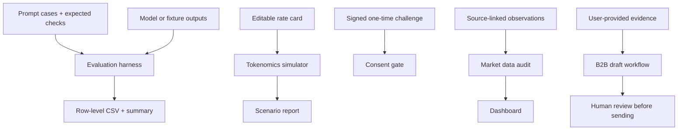

# PromptlyAI Research Portfolio — Reproducible Applied AI Research

> **Scope:** independent, reproducible research artifacts for LLM evaluation, inference-cost modelling, consent safeguards, market-observation auditing, and human-reviewed B2B workflow design.
>
> **Evidence standard:** synthetic fixtures are labelled as synthetic. A demo run proves that the code path executes; it does **not** prove a model is accurate, establish a vendor's current price, reproduce a private company's production system, or validate a legal claim.

## What is implemented

| Workstream | Implemented artifact | What it demonstrates | What it does not claim |
|---|---|---|---|
| LLM evaluation | `src/promptly_research/eval_harness.py` | Row-level evaluation of supplied outputs for required content, JSON structure/value checks, refusal signals, and forbidden markers | No model was called by the included fixture run; fixture pass rate is not model quality |
| Token economics | `src/promptly_research/tokenomics.py` | Cost arithmetic for configurable input/output token rates, easy/hard routing, and cache-hit assumptions | Sample rate card is illustrative, not a current provider quote; no measured “6x moat” claim |
| Voice workflow safety | `src/promptly_research/voice_consent.py` | Expiring, signed one-time challenge validation and replay rejection | Transcript matching is not speaker identification, proof of legal consent, or deepfake detection |
| Pricing/funding observations | `src/promptly_research/market_watch.py` | CSV validation and change summaries for source-linked observations | Not a live scraper; no real vendor prices or funding claims are shipped as facts |
| B2B workflow | `src/promptly_research/b2b_workflow.py` | Evidence-bounded outreach drafting with human approval required | Does not scrape company sites, enrich personal data, or send messages |

## Architecture



## Quick start (Windows PowerShell)

Use Python 3.11 or newer.

```powershell
py -m venv .venv
.\.venv\Scripts\Activate.ps1
python -m pip install --upgrade pip
pip install -e ".[dev,dashboard]"
pytest
python scripts/run_evaluation.py --benchmark benchmarks/synthetic_benchmark.jsonl --outputs benchmarks/fixtures/deterministic_demo_outputs.jsonl --csv reports/demo_fixture_results.csv --summary reports/demo_fixture_summary.json
python scripts/run_cost_simulation.py --config config/rate_card.example.json --output reports/illustrative_cost_scenario.json
python scripts/audit_market_data.py --input data/market_observations_demo.csv --output reports/demo_market_audit.json
streamlit run app.py
```

The evaluation fixture contains deliberately imperfect examples so the evaluator demonstrates both passing and failing checks. The report labels its adapter as `deterministic_demo_fixture`; do not present its metrics as a model benchmark. The output schema also has optional columns for provider/model/run metadata, request latency, TTFT, token counts, and externally supplied judge scores. A real provider adapter must measure/populate them; `evaluator_runtime_ms` is only the local checker runtime. See [`docs/evaluation_protocol.md`](docs/evaluation_protocol.md) for the measurement boundaries and [`docs/provider_adapter_contract.md`](docs/provider_adapter_contract.md) for the output contract. A helper for measuring the latency of a supplied streaming SDK iterator is in `src/promptly_research/streaming_adapter.py`; it makes no provider calls by itself.

## Replacing fixtures with real evidence

1. **Model evaluation:** add a provider adapter that writes one JSONL object per `case_id` with `response` and `adapter`. Record provider/model/version, prompt-template version, run date, decode parameters, and token usage. Run repeated trials where outputs are stochastic. Keep raw outputs and row-level failures.
2. **Cost modelling:** replace the example rate card with dated figures copied from official pricing pages or contracts. Save the source URL, access date, currency, caching treatment, and any batch/volume discounts. Run a sensitivity analysis, not just one optimistic scenario.
3. **Voice safety:** wire in an explicit consent UX and a proper identity/authorization control appropriate to the product. The included gate is a small demonstration only. Never rely on spoken passphrase matching alone to authorize voice cloning.
4. **Market observations:** populate the CSV only after manually checking primary sources or writing source-specific adapters that respect each provider's terms and robots guidance. Keep a timestamp and evidence URL for each row. Do not describe the tracker as real-time until a scheduled ingestion path has been deployed and monitored.
5. **B2B workflow:** provide factual, non-sensitive company evidence yourself; review all output; do not send automatically. Validate contact sourcing, consent and applicable outreach rules before integrating any CRM.

## Data provenance and privacy

- `benchmarks/synthetic_benchmark.jsonl`: generated synthetic test cases.
- `benchmarks/fixtures/deterministic_demo_outputs.jsonl`: hand-authored deterministic fixtures, not outputs from a language model.
- `config/rate_card.example.json`: illustrative assumptions; not vendor rates.
- `data/market_observations_demo.csv`: clearly marked fictional rows to demonstrate the audit/dashboard path.
- `data/market_observations_template.csv`: empty schema for verified observations.
- No company-confidential data, personal contact data, credentials, or proprietary source code should be committed.

Do **not** add an NDA disclaimer unless a real NDA/proprietary restriction applies and the statement has been approved. This repository is an independent public portfolio; it does not assert that it reproduces Promptly AI's internal methodology.

## Resume bullets supported by the current code

Use these only after you run the tests and can explain the implementation:

- Built a Python evaluation harness that audits supplied LLM outputs for required-content coverage, JSON schema/value validity, refusal behavior, and forbidden markers, exporting case-level CSV evidence.
- Implemented an assumption-driven inference-cost simulator for model routing and semantic-cache hit rates, with editable rate cards and explicit sensitivity inputs.
- Prototyped a signed, expiring one-time challenge gate with replay rejection for consent-sensitive voice workflows, documenting the limitations of transcript-only verification.
- Developed a source-linked market-observation validator and dashboard scaffold for pricing and funding data; live vendor ingestion remains a separate implementation task.
- Built a human-in-the-loop B2B outreach draft workflow that constrains personalization to user-supplied evidence and requires approval before sending.

Do **not** claim “30+ tools benchmarked,” “6x cost advantage,” “prevented legal liability,” “real-time price bot,” or “₹8 Cr+ funding tracked” on the strength of this repository alone. Those require distinct, auditable evidence.

## Roadmap

- [ ] Add provider-specific model adapters and repeatable real-model benchmark runs.
- [ ] Add dated official source records to the rate card and market observations.
- [ ] Add confidence intervals and paired comparisons across models.
- [ ] Add source-specific permitted price ingestion with change detection and alerting.
- [ ] Add persistent, atomic replay protection and an explicit consent-record lifecycle for any real deployment.
- [ ] Add structured evaluation of B2B draft factuality and human-review outcomes.

## License

MIT for the original code in this repository. Third-party model weights, datasets, provider APIs, and source-page content remain subject to their own terms.
